<!-- ============================ HERO ============================ -->
<div align="center">


<a href="https://github.com/sm-sazzad">
  
</a>

<br/><br/>

<a href="https://github.com/sm-sazzad"></a>
<a href="https://www.linkedin.com/in/sm-sazzad/"></a>
<a href="mailto:sazzadhossain5758@gmail.com"></a>


<br/><br/>

<b>
<a href="#-about">About</a> &nbsp;•&nbsp;
<a href="#-tech-stack">Stack</a> &nbsp;•&nbsp;
<a href="#-roadmap">Roadmap</a> &nbsp;•&nbsp;
<a href="#-github-analytics">Analytics</a> &nbsp;•&nbsp;
<a href="#-connect">Connect</a>
</b>

</div>


<!-- ============================ ABOUT ============================ -->

## 🧑‍💻 About

```js
const sazzad = {
  name: "Sheikh Md Sazzad Hossain",
  role: "Web Developer",
  studying:
    "Computer Science & Technology @ Kushtia Polytechnic Institute (6th Semester)",
  focus: ["React", "TypeScript", "Next.js", "Tailwind CSS"],
  learning: ["Advanced JavaScript", "Data Structures & Algorithms"],
  mindset: "Learn → Build → Solve → Improve → Repeat",
  goal: "Become a skilled Software Engineer 🚀",
  Email: "sazzadhossain5758@gmail.com",
};
```

I'm passionate about building **modern, fast and user-friendly** web experiences. I enjoy learning new technologies, solving programming problems, and turning ideas into real-world projects. Web development is the foundation I'm using to grow into a versatile software engineer — one project at a time.


<!-- ============================ STACK ============================ -->

## 🛠️ Tech Stack

<div align="center">

<table>
<tr>
<td align="center" width="33%">

**💻 Languages**<br/><br/>


</td>
<td align="center" valign="top" width="33%">

**⚛️ Frameworks & Libraries**<br/><br/>


</td>
<td align="center" width="33%">

**🧰 Tools & Platforms**<br/><br/>


</td>
</tr>
</table>

</div>


<!-- ============================ ROADMAP ============================ -->

## 🧭 Roadmap

```mermaid
flowchart LR
    A([HTML · CSS · JS]) --> B([Tailwind CSS])
    B --> C([TypeScript])
    C --> D([React])
    D --> E([Next.js])
    E --> F([Better Auth])
    F --> G{{🚀 Frontend Developer}}

    style A fill:#24243e,stroke:#a855f7,color:#fff
    style B fill:#24243e,stroke:#a855f7,color:#fff
    style C fill:#24243e,stroke:#00d4ff,color:#fff
    style D fill:#24243e,stroke:#00d4ff,color:#fff
    style E fill:#24243e,stroke:#00d4ff,color:#fff
    style F fill:#24243e,stroke:#a855f7,color:#fff
    style G fill:#a855f7,stroke:#00d4ff,color:#fff
```




<!-- ============================ ANALYTICS ============================ -->

## 📊 GitHub Analytics

<div align="center">


<br/><br/>


<br/><br/>


<br/>


</div>

<!-- Uncomment after running the "Generate Snake" workflow once (snake.yml) -->
<div align="center">
  
</div>


<!-- ============================ CODING PROFILES ============================ -->

## 🌐 Coding Profiles

<div align="center">

<a href="https://codeforces.com/profile/sm-sazzad"></a>
<a href="https://www.codechef.com/users/sm_sazzad"></a>

</div>


<!-- ============================ CONNECT ============================ -->

## 🤝 Connect

<div align="center">

<a href="https://www.linkedin.com/in/sm-sazzad/"></a>&nbsp;&nbsp;
<a href="https://www.facebook.com/sazzad.hossain.5758" style="text-decoration: none; border: none;">

</a>&nbsp;&nbsp;
<a href="https://x.com/sm_sazzad58"></a>&nbsp;&nbsp;
<a href="mailto:sazzadhossain5758@gmail.com"></a>

<br/><br/>


<br/>

### 🚀 Always Learning. Always Building.

⭐ If you like my work, feel free to explore my repositories!

</div>


